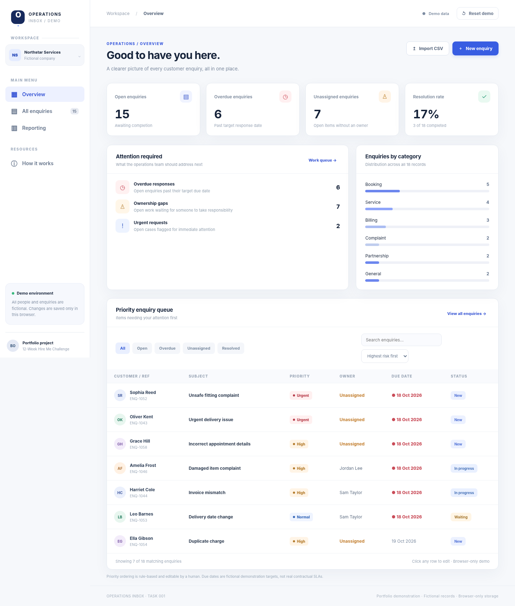

# Operations Inbox

**TASK 001 · Business Process Rescue · 12-Week Hire Me Challenge**  
Challenge window: **19–25 October 2026** · Planned effort: **6–8 hours**

A working, browser-based operations dashboard for a fictional UK small business. It transforms a scattered enquiry-handling process into a trackable queue with human-editable priority, ownership, due dates and operational reporting.



> **Portfolio demonstration, not a live customer-service system.** All customers and staff are fictional. Records stay in your browser's local storage. There is no shared backend, authentication, live mailbox or paid AI API.

## Why this exists

Small teams often use a mixture of email and spreadsheets to track customer enquiries. That can obscure who owns a request, whether it is overdue and what is still open. This application demonstrates practical business analysis, data-quality controls, lightweight implementation, testing and stakeholder reporting rather than showcasing AI as the product.

## Try the demonstration

**Vercel production deployment:** [Open Operations Inbox](https://operations-inbox-hire-me.vercel.app) (Vercel state: **READY**, with deployment authentication disabled; independent live HTTP retrieval was blocked in the test environment).

The app starts with 18 fictional enquiries, including deliberately overdue, unassigned, urgent and resolved cases. Choose a row to review or change its category, priority, owner, status, target date and internal notes. Changes persist in the same browser. Use **Reset demo** to restore the example data.

### Capabilities

- Seeded fictional enquiry queue and a manual **New enquiry** workflow
- Import `.csv` files with row-by-row validation and duplicate-ID detection
- Deterministic, inspectable category/priority rules and human overrides
- Ownership, status and target due-date management
- Overdue and unassigned filters, search and risk-first sorting
- Live KPIs: total, open, overdue, unassigned, urgent and resolved rate
- Export full CSV and a plain-language operational summary (`.md`)
- Responsive desktop/mobile interface and accessible labels

## Technology and trade-offs

- **TypeScript, HTML and CSS** with no runtime libraries
- **Vercel** static hosting; no server required
- **Node.js built-in test runner** for business-rule tests
- **Browser automation** for scripted interaction checks

I considered Next.js, but deliberately chose static TypeScript for this one-screen, single-user proof of concept. A framework, database and authentication layer would add maintenance, dependencies and unproven requirements, not employer-relevant evidence for this 6–8 hour task. This decision is documented rather than hidden.

## Run locally

The compiled JavaScript is committed with the source, so no installation is required to preview it:

```bash
python -m http.server 8000
# Open http://localhost:8000
```

For contributors with Node.js and TypeScript installed:

```bash
npm install
npm run build
npm run check
```

`npm run build` compiles `src/*.ts` and generates `assets/app-bundle.js`. `standalone-demo.html` contains the compiled app and styles in a single portable HTML file. Don't hand-edit generated JS. If TypeScript isn't installed locally, install dependencies with `npm install` first.

## CSV format

Required columns: `customer,email,subject,message,receivedAt`. Optional columns: `id,dueAt,category,priority,owner,status,notes,resolvedAt`.

```csv
customer,email,subject,message,receivedAt
Taylor Jones,taylor.jones@example.com,Invoice question,Could you check our latest invoice?,2026-10-19T09:00:00Z
```

Use ISO 8601 dates. Quote fields containing commas, newlines or quotes. Unsupported or invalid rows are skipped; an import summary shows a sample of row errors. Import does not overwrite a matching ID. Category and priority are suggested from the text if not supplied, and an explicit valid value takes precedence.

## Rules and metric definitions

- **Open**: any status except `Resolved`.
- **Overdue**: an open enquiry with a target due date earlier than the current time.
- **Unassigned**: an open enquiry whose owner is `Unassigned`.
- **Urgent open**: an open enquiry with priority `Urgent`.
- **Resolved rate**: resolved ÷ total enquiries × 100, rounded to the nearest integer. This is **not** a customer satisfaction metric or SLA compliance rate.
- **Default target windows**: urgent 4h; high 24h; normal/low by category (Booking/Complaint 24h, Billing/Service 48h, General 72h, Partnership 120h).
- **Sorting**: urgent, overdue and ownership risks influence the default work queue order; users can sort by due date or receipt date instead.

These are illustrative demo rules, not agreed customer service policies. Staff can manually edit the fields and dates.

## Project evidence

| Resource | Location |
|---|---|
| Short requirements, scope and acceptance criteria | [Specification](docs/SPECIFICATION.md) |
| Job advert research and skills map | [Employment research](docs/JOB_RESEARCH.md) |
| Test approach and observed results | [Validation report](docs/VALIDATION.md) |
| Employer-facing case study | [Case study](docs/CASE_STUDY.md) |
| Two-minute walk-through and CV statements | [Portfolio pack](docs/PORTFOLIO_PACK.md) |
| Screenshots | [screenshots/](screenshots/) |
| Polished employer case study (PDF) | [Employer case study](docs/EMPLOYER_CASE_STUDY.pdf) |

## Privacy, safety and limitations

**Do not import real customers' personal data into this public portfolio demo.** The app stores browser-local data but provides no authentication, shared-team synchronisation, access permissions, audit log, automated notifications, attachment security, retention controls or GDPR-grade handling. The synthetic `.example.com` emails are intentionally non-deliverable. Export files are generated locally. Refreshing preserves data in the same browser unless storage is cleared, and reset replaces it.

A production implementation would require stakeholder discovery, validated SLAs, role-based access, a suitable backend, data protection assessment, audit events and monitoring. Those are explicitly outside this challenge.

## Employment relevance

This repository is evidence of an end-to-end operational improvement exercise: problem definition, decision rules, data model, exception handling, user workflows, quality assurance, implementation trade-offs and concise reporting. It does **not** claim real-world business ROI or customer adoption.

**Prepared for TASK 001 of the 12-Week Hire Me Challenge.** [Public project repository](https://github.com/BradleyDevelopmentLDN/operations-inbox-hire-me). The demo was deployed separately through the Vercel API and is not yet connected to automatic Git-based deployment. See [`docs/DEPLOYMENT.md`](docs/DEPLOYMENT.md).
